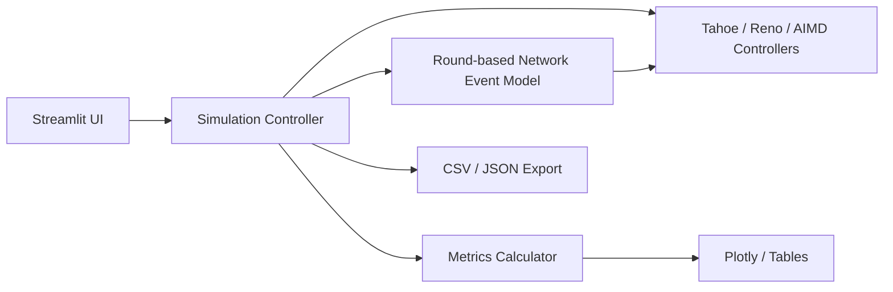

# System Architecture

## Components

1. **User interface** — collects experiment parameters and presents charts, tables, validation status, and downloads.
2. **Simulation controller** — creates the selected congestion controller and executes a fixed number of RTT rounds.
3. **Congestion-control modules** — implement the cwnd update rules for Tahoe, Reno, and AIMD.
4. **Network-event model** — independently samples packet loss for packets sent in each round and maps observed loss count to simplified feedback.
5. **Metrics module** — calculates throughput, loss rate, average cwnd, congestion-event count, and observed recovery time from simulation records.
6. **Visualization/export** — converts actual results into charts, tables, CSV files, and JSON configuration files.

## Data flow

A sender begins a round with a current congestion window. It sends that many modeled packets. Each packet is independently marked lost according to the configured probability. Successful packets represent acknowledgements. A loss produces either a triple-duplicate-ACK event for a single lost packet or a timeout event for two or more lost packets. The congestion controller updates cwnd and ssthresh. The next RTT begins with those values.
